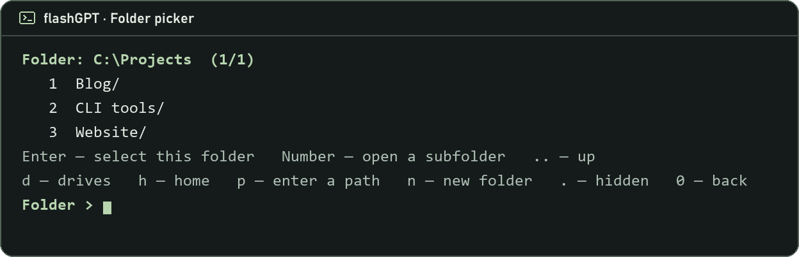
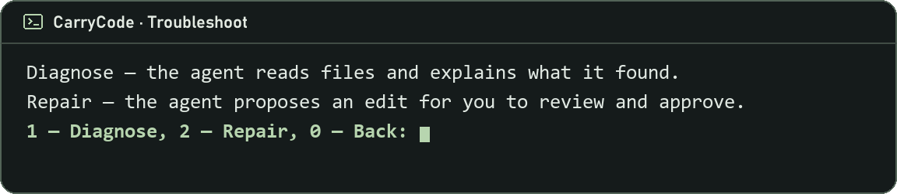

  <h1></h1>
  
Take CarryCode, Codex CLI, OpenCode, and your encrypted profile with you on USB.

  

    <a href="https://github.com/harzer228/flashGPT/releases/latest/download/flashGPT-setup-windows-x64.exe"><strong>Windows installer ↓</strong></a>
    · <a href="https://github.com/harzer228/flashGPT/releases/latest">Portable ZIP</a>
    · <a href="#quick-start">Quick start</a>
    · <a href="../README.md">Документация на русском</a>
  

  

    
    · <a href="../LICENSE">MIT license</a>
  

## Quick start

1. On **Windows 11**, run the installer and select a destination such as `F:\CarryCode`. For manual installation or installation from Linux, extract the portable ZIP. To update from flashGPT, close both clients and choose your existing bundle folder. [Downloads and SHA-256 checksums](https://github.com/harzer228/flashGPT/releases/latest)
2. Run `flashGPT.exe` on Windows. On **Ubuntu 24.04 LTS** or **Arch Linux**, open a terminal in the bundle folder and run `./flashgpt`. The bundle targets x86-64.
3. Create and remember your profile password, or unlock your existing flashGPT profile. Pick a coding agent and project folder. Sign in from Codex or use `/connect` in OpenCode. For English menus, choose **6 → 2**.

The CLI runs on the connected computer. Models run remotely and require internet access and a provider sign-in. Bundle checks work offline.

## What you can do

| Task | In CarryCode |
| --- | --- |
| **Start coding** | Pick a folder with the arrow keys, search by name with **/**, or press **Tab** to revisit a recent folder. |
| **Troubleshoot** | Investigate in read-only mode, then review and approve a single text replacement in a project file. |
| **Check the bundle** | See which checks passed, failed, or were skipped, with a next step for each failure. |
| **Move between computers** | Unlock your profile to use the credentials and settings you saved. Close the menu before ejecting the drive. |
| **Change your password** | Use menu item **7** to re-encrypt your profile with a new password. |
| **Open on plug-in** | Use menu item **5** to enable or disable autostart on the current computer. |

## Inside the terminal

### Folder picker

### Diagnose and repair

## Build and contribute

The launcher is written in Rust. Follow the [build instructions](../README.md#сборка) to assemble it with the official CLI binaries, or run `cargo test --locked --workspace` to run the workspace tests. See [profile security](../SECURITY.md) for how local sessions handle credentials.

Found a bug? [Open an issue](https://github.com/harzer228/flashGPT/issues/new) with your operating system, CarryCode version, and steps to reproduce it.
