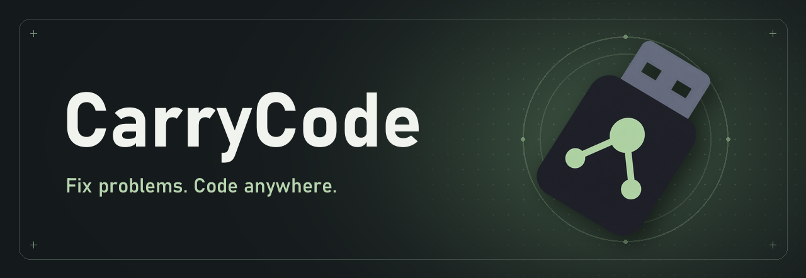

  <h1></h1>
  

    <a href="https://github.com/harzer228/CarryCode/releases/download/v0.1.0-beta.6.1/CarryCode-Lite-Setup-Windows-x64.exe"><strong>Windows Lite</strong></a>
    · <a href="https://github.com/harzer228/CarryCode/releases/download/v0.1.0-beta.6.1/CarryCode-Full-Setup-Windows-x64.exe"><strong>Windows Full</strong></a>
    · <a href="https://github.com/harzer228/CarryCode/releases/tag/v0.1.0-beta.6.1">Portable ZIPs, release notes and SHA-256</a>
    · <a href="../README.md">На русском</a>
    · <a href="../CHANGELOG.md">Changelog</a>
  

**CarryCode is for developers who switch between computers and want their AI coding setup available on each one.** Take the launcher, Codex CLI, OpenCode, and your encrypted profile on one USB drive. Open a local project to resume coding or investigate a problem.

**Fix problems. Code anywhere.** The USB drive carries the tools and profile. Models run on your provider's servers. AI features require internet access and a provider sign-in.

## Native agent preview

The native agent can create projects, review groups of file changes, and run confirmed PowerShell or Bash commands. Open `/project` for Web, Python, and Rust starters. Use `/tools` for the current tool list.

`/browser` controls installed Chromium, Chrome, or Edge in the background. It exposes the page accessibility tree, console messages and screenshots. Enable **Images** in `/model` to let a vision model inspect a screenshot. On Windows, `/computer` selects a single application window. New conversations start in **Approve for me** mode. **F6** changes permissions during a turn. Model settings take effect with the next user message.

`/search query` sends a web search directly to Mwmbl over the internet in new agent profiles. The built-in option works in Lite and Full without Docker, an API key, or a separate install. Existing profiles can select **Built-in search** in `/search`. Anonymous queries have per-IP limits. The same menu can disable search or connect Brave Search or a SearXNG server with JSON enabled. Press **Esc** to cancel a pending search. [Mwmbl API and limits](https://developer.mwmbl.org/)

Open `/model` to add models with **A**, reuse the selected connection with **N**, or choose from its catalog with **F4**. Saving with blank limits looks them up in the catalog and asks you to fill in any remaining fields. **F5** checks reasoning with a short test request. Final replies show elapsed time, token use and generation speed. `@` attaches a project text file without expanding it in chat. On Windows, **F7** pastes directly from the clipboard and groups long text into a compact attachment. [Agent instructions](../README.md#carrycode-agent--экспериментальная-альфа)

## Demo

Plug in the USB drive, open CarryCode, pick Codex or OpenCode, and choose the project folder. The demo uses a test profile and stops before provider sign-in.

## Quick start

1. **Prepare the drive.** Download the Windows installer or portable ZIP and check SHA-256 before running or extracting it. Point the installer or ZIP extraction at one folder on the USB drive, such as `F:\CarryCode`. [Download and verification steps](../README.md#проверка-загрузки)
2. **Open the launcher.** Run `flashGPT.exe` on Windows or `./flashgpt` from the bundle folder on Linux. Create and remember a password, or unlock your existing profile. For English, press **Enter** at the first-run agent prompt to reach the main menu, then choose **6 → 2**.
3. **Choose an agent and project folder.** Use the arrow keys and **Enter** to open folders, then select **Choose this folder** or press **F2**. Sign in through Codex or use `/connect` in OpenCode.
4. **Move to another computer.** Exit the CLI, wait for the profile to save, and close the menu before ejecting. Run CarryCode from the same USB bundle and unlock it with the same password.

**Lite** contains the launcher and CarryCode Agent. **Full** also bundles Codex CLI and OpenCode for Windows and Linux. Beta 6.1 may contain bugs.

On Windows, open PowerShell in the download folder and run `Get-FileHash -Algorithm SHA256 .\CarryCode-Full-Setup-Windows-x64.exe`, or use the Lite filename. Compare the result with the matching `.exe.sha256` file from the same release. For ZIP downloads on Linux, run `sha256sum -c SHA256SUMS` for Full or `sha256sum -c SHA256SUMS-lite` for Lite. The Windows installers are unsigned.

## Supported systems

| OS | Architecture | Start from the bundle folder |
| --- | --- | --- |
| Windows 11 | x86-64 | Open `flashGPT.exe` |
| Ubuntu 24.04 LTS | x86-64 | Run `./flashgpt` in a terminal |
| Arch Linux | x86-64 | Run `./flashgpt` in a terminal |

## Requirements and limits

- **Host access.** Use a trusted computer, an interactive terminal, and standard user permissions. Use a writable USB drive. On Linux, the file permissions and mount options must allow execution.
- **Cloud access.** Sign in to the provider you use. The model stays on the provider's servers. The installer and local bundle checks can run offline.
- **What travels.** Your profile stores supported CLI settings and saved sign-in data. Project files stay wherever you keep them. Use a project folder available on each computer.
- **Troubleshooting.** Menu **4** reports passed, failed, and skipped checks. Menu **3** offers read-only investigation or a reviewed replacement in one existing project text file. Verify the diagnosis before applying a change.
- **Autostart.** Enable it separately on each computer if you want CarryCode to open when the registered drive is attached. Manual launch works with the executable names above.

To update a flashGPT installation, close the launcher and its CLI clients, then select the existing bundle folder. Keep `flashgpt.json` and `profile/` together and use your existing password. The executable names remain compatible with existing shortcuts and scripts.

## Contribute

Try the quick start, report a reproducible bug, or propose an improvement to the USB workflow. [Contributor guide](../CONTRIBUTING.md) · [Issue forms](https://github.com/harzer228/flashGPT/issues/new/choose) · [Profile security](../SECURITY.md)

## CLI tools in Full

- **Option 1** opens OpenAI's official terminal coding agent. [Codex CLI on GitHub](https://github.com/openai/codex)
- **Option 2** opens OpenCode. [OpenCode on GitHub](https://github.com/anomalyco/opencode)

The pinned versions and archive SHA-256 hashes are listed in [runtimes.lock.json](../runtimes.lock.json).
