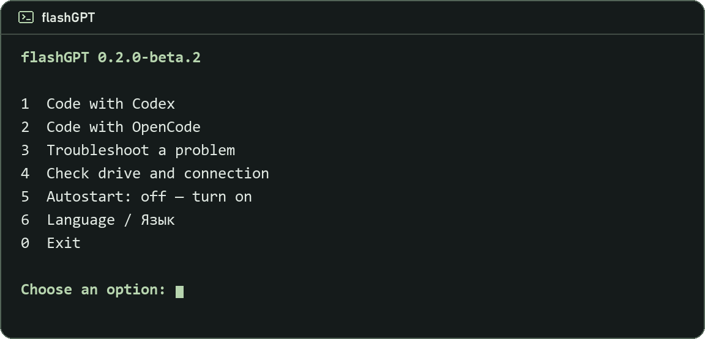

  <h1></h1>
  
Carry Codex CLI, OpenCode, and your encrypted profile on one USB drive.

  

    <a href="https://github.com/harzer228/flashGPT/releases/tag/v0.2.0-beta.2"><strong>Download beta ↓</strong></a>
    · <a href="#quick-start">Quick start</a>
    · <a href="../README.md">Документация на русском</a>
  

  

    
    · <a href="../LICENSE">MIT license</a>
  

## Quick start

1. Download `flashgpt-usb-amd64.zip` and `SHA256SUMS` from the [beta release](https://github.com/harzer228/flashGPT/releases/tag/v0.2.0-beta.2). Verify the ZIP and extract it to a folder on your USB drive.
2. Run `flashGPT.exe` on **Windows 11**. On **Ubuntu 24.04 LTS** or **Arch Linux**, open a terminal in the extracted folder and run `./flashgpt`. The bundle targets x86-64.
3. Create a profile password. Pick a coding agent, select a working folder in the terminal, and sign in to your provider on first use. For English menus, choose **6 → 2**.

The CLI runs on the connected computer and uses the chosen cloud provider over the internet.

## What you can do

| Task | In flashGPT |
| --- | --- |
| **Start coding** | Launch either official CLI in the folder you pick. |
| **Troubleshoot** | Use Diagnose for read-only investigation or Repair for edits with the CLI’s permissions. |
| **Move between computers** | Unlock your profile to use the credentials and settings you saved. Close the menu before ejecting the drive. |
| **Open on plug-in** | Use menu item **5** to enable or disable autostart on the current computer. |

## Inside the terminal

### Folder picker

### Diagnose and repair

## Build and contribute

The launcher is written in Rust. Follow the [build instructions](../README.md#сборка) to assemble it with the official CLI binaries, or run `cargo test --locked --workspace` to run the workspace tests. See [profile security](../SECURITY.md) for how local sessions handle credentials.

Found a bug? [Open an issue](https://github.com/harzer228/flashGPT/issues/new) with your operating system, flashGPT version, and steps to reproduce it.
