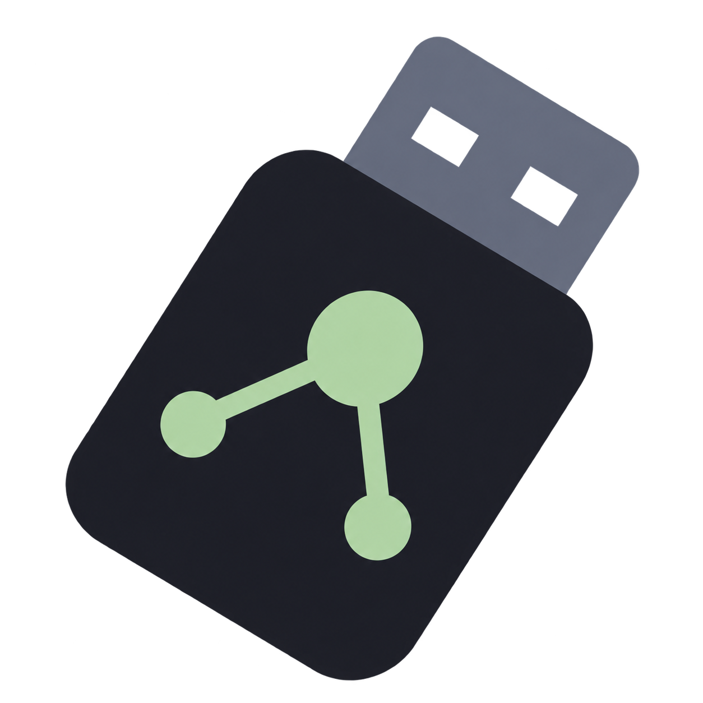

# CarryCode

**Fix problems. Code anywhere.** [English quick start](.github/README.md#quick-start) · [История изменений](CHANGELOG.md)

CarryCode пригодится, если ты работаешь с кодом на нескольких компьютерах. Лаунчер, Codex CLI, OpenCode и зашифрованный профиль можно держать на одной флешке, чтобы на другом ПК открыть проект и продолжить работу или разобраться с ошибкой. Модели работают у облачного провайдера. Для AI-функций нужны интернет и вход в аккаунт.

## CarryCode Agent — экспериментальная альфа

После локальной сборки открой пункт **1 — CarryCode Agent CLI** и выбери папку. В `/provider` сохрани подключение, затем в `/model` добавь модель. Поддерживаются OpenAI Chat Completions, OpenAI Responses и Anthropic Messages. Укажи базовый адрес, например `https://example.org/v1`. Для локального сервера допускается HTTP на localhost. Для Melious используй `https://api.melious.ai/v1`, ID модели и ключ из своего аккаунта.

Агент читает и ищет код, создаёт файлы, предлагает группы изменений и запускает команды после подтверждения. История и настройки сохраняются в зашифрованном профиле. Прокрутка работает колесом мыши, **PgUp/PgDn** и **Shift+↑/↓**. Команда `/exit` возвращает в основное меню.

### Проекты, shell и браузер

- `/project` создаёт минимальный Web-, Python- или Rust-проект с тестом и инструкцией. Выбери «С нуля» и опиши задачу, если нужна своя структура. Перед записью агент покажет список файлов и diff. `/undo` может отменить последнюю группу, пока её файлы совпадают с записанным результатом.
- `/tools` показывает доступные действия. Команды и диффы открываются прямо в чате. Когда требуется подтверждение, **Enter** применяет показанное действие, **Esc** отменяет его. Во время выполнения **Esc** останавливает дерево процессов и оставляет собранный вывод.
- `/permissions` или **F6** открывает режим диалога и правила подтверждения действий. **Агент** может работать с инструментами, а **Только чат** отвечает без них. Новый диалог открывается в режиме агента. `/sessions` восстанавливает режим сохранённого диалога. Режим диалога и параметры модели, изменённые во время ответа, вступают в силу со следующего сообщения.
- Для подтверждения действий доступны режимы **Запрашивать разрешение**, **Подтверждать за меня** (по умолчанию) и **Полный доступ**. Автоматические команды выполняются на временной копии проекта с AppContainer на Windows или Bubblewrap на Linux. Если изоляция недоступна, CarryCode предлагает отдельно подтвердить один запуск с правами текущего пользователя. Запрос агента на изменение этих правил выделен цветом.

- На Windows CarryCode выбирает PowerShell 7, а при его отсутствии — Windows PowerShell 5.1. На Linux используется Bash. В выводе отдельно указаны код завершения, stdout и stderr.
- Скрытый Chromium, Chrome или Edge запускается при первом обращении агента. `/browser` управляет доступностью. Снимки страницы поддерживаются у моделей с включённым параметром **«Изображения»** в `/model`.
- В Windows агент сам находит нужное окно и запрашивает согласие один раз на чат. **Полный доступ** пропускает запрос. Управление можно выключить в `/setting`. **F8** в агенте или **Ctrl+Alt+Shift+F12** на рабочем столе останавливает управление.
- `/search запрос` показывает результаты интернет-поиска. В новых профилях агента запросы идут напрямую в Mwmbl через интернет. Встроенный поиск доступен в Lite и Full без Docker, API-ключа и отдельной установки. Для существующего профиля его можно выбрать в `/search` → **Встроенный поиск · Mwmbl без ключа**. У анонимного доступа есть лимиты на IP-адрес. **Esc** отменяет ожидание. [API и лимиты Mwmbl](https://developer.mwmbl.org/)
- В `/search` также можно выключить поиск, указать ключ Brave Search или подключить свой SearXNG. Для локального варианта запусти SearXNG на `127.0.0.1:8080` и включи `json` в `search.formats`. CarryCode проверит его коротким запросом. [Установка SearXNG](https://docs.searxng.org/admin/installation.html) · [Настройка JSON API](https://docs.searxng.org/dev/search_api.html)

### Провайдеры и модели

`/provider` хранит название, базовый URL, протокол и скрытый API-ключ. Одно подключение можно использовать для нескольких моделей. Ключ хранится один раз в зашифрованном профиле. При смене адреса или протокола введи ключ для нового подключения либо нажми **F4**, чтобы сохранить его без ключа.

`/model` группирует модели по провайдерам. Нажми **A** и выбери подключение, чтобы ввести ID вручную. **F4** открывает каталог с поиском. Печатай ID или имя, отмечай модели клавишей **Tab**, затем проверь список перед добавлением. Сохранённые модели остаются со своими настройками. **Enter** выбирает модель, **E** открывает правку, **D** удаляет запись.

**F5** заполняет пустые поля по каталогу и показывает значения для проверки. Для Melious агент запрашивает расширенные метаданные и при необходимости уточняет лимиты по точному ID модели. Если отдельный предел входа не указан, CarryCode использует размер окна как локальный предел входа. Отсутствующие окно и выход нужно ввести вручную. **T** в списке моделей отправляет один короткий тест без истории, файлов и инструментов. Результат отдельно показывает, принял ли API запрос и есть ли в ответе признаки reasoning.

Контекст, вход и выход задаются отдельно. Например, для всех трёх полей можно указать `1048576`. Перед отправкой CarryCode оценивает размер входа с учётом истории, инструкций и инструментов, затем ограничивает выход остатком окна. `/status` показывает обе оценки. Если места для ответа или обязательного бюджета reasoning не хватает, причина появится в чате.

Введи `@`, чтобы выбрать файл или папку проекта. **Ctrl+C** копирует выделенный текст, в том числе строки, ушедшие за край при прокрутке. `/sessions` открывает сохранённые диалоги, а `/new` начинает чат с чистой статистикой.

### Reasoning

`/reasoning` показывает доступные уровни активной модели. Можно указать уровень сразу, например `/reasoning high`. **F3** в форме модели открывает список с галочками. **Пробел** отмечает или снимает уровень, **Enter** применяет список к форме, **Esc** отменяет изменения. Сохрани модель, чтобы `/reasoning` показывал отмеченные уровни. «По умолчанию» доступно всегда. **F2** в списке открывает расширенные сопоставления API, в том числе для `ultra`. Предустановки формата API не означают, что модель их поддерживает. `default` оставляет решение провайдеру. `off` явно отключает thinking в DeepSeek и учитывает заданное сопоставление у других шлюзов. Для Anthropic доступны фиксированные бюджеты `low`, `medium` и `high` и режим Adaptive. Поддержка остальных уровней зависит от модели и формата API.

Поток рассуждения отображается вместе с ответом. **F3** его разворачивает. **F2** открывает подробности инструментов. Ошибки провайдера видны в прокручиваемой панели.

### Скиллы

Скилл — это папка с `SKILL.md`: YAML-заголовок с `name` и `description`, затем инструкции в Markdown. Агент показывает список в `/skills`, подгружает инструкции по запросу модели и передаёт их как доверенное руководство проекта. Формат совместим с Claude Code, поэтому подойдут существующие скиллы.

| Где искать | Назначение |
| --- | --- |
| `<проект>/.carrycode/skills/<имя>/SKILL.md` | только этот проект |
| `skills/<имя>/SKILL.md` в папке комплекта | вместе с флешкой |
| `%USERPROFILE%\.carrycode\skills\<имя>\SKILL.md` | все проекты пользователя |
| `%USERPROFILE%\.agents\skills`, `.claude\skills`, `.codex\skills` | общие наборы других агентов |

В бинарник входят скиллы создания проекта, реализации функций, написания тестов, запуска и проверки, работы с браузером и рабочим столом, создания runbook, упрощения, поиска документации и баг-репортов. `/skills` позволяет посмотреть и использовать скилл, `/skill <имя> <задача>` вызывает его напрямую. Встроенные `code-review`, `debug-project` и `skill-writer` также доступны. В `skill-writer` лежит готовый промт для ChatGPT: скопируй его, подставь свою задачу и сохрани полученный `SKILL.md` в одну из папок выше. Первый скилл с таким именем выигрывает, поэтому проектный вариант перекрывает встроенный.

### MCP

Агент умеет запускать локальные MCP-серверы по stdio и вызывать их инструменты. Включённые серверы из `~/.carrycode/mcp.json` запускаются автоматически. Серверы из `<проект>/.carrycode/mcp.json` и `<проект>/.mcp.json` требуют согласия: открой `/mcp`, выбери сервер и нажми **Enter** для просмотра параметров запуска. Согласие действует для этой конфигурации до выхода из агента; без него одноимённый пользовательский сервер продолжит работать.

```json
{
  "servers": {
    "filesystem": {
      "command": "npx",
      "args": ["-y", "@modelcontextprotocol/server-filesystem", "C:\\project"],
      "env": {"TOKEN": "..."},
      "enabled": true,
      "startup_timeout_sec": 20,
      "tool_timeout_sec": 120
    }
  }
}
```

`/mcp` показывает состояние серверов и их инструменты, перезапускает их и импортирует готовые конфигурации из Claude Code (`~/.claude.json`), Codex (`~/.codex/config.toml`) и OpenCode (`opencode.jsonc`). Импорт записывает выбранные серверы в пользовательский файл CarryCode. Каждый вызов MCP-инструмента показывается отдельным подтверждением с аргументами; секретные поля вроде `token` и `password` в нём скрыты. Поддерживается только stdio; удалённые HTTP/SSE-серверы пока не подключаются. Конфигурация может содержать ключи — не добавляй её в Git.

### /init

`/init` собирает сведения о проекте (стек, команды проверки, верхний уровень структуры) и показывает готовый `AGENTS.md` в прокручиваемом предпросмотре. **Enter** создаёт файл, **Esc** отменяет. Существующий `AGENTS.md` не перезаписывается. Файл читает встроенный агент, а также другие инструменты, которые поддерживают это соглашение.

### Планирование без правок

Введи `/plan` и опиши задачу. Агент может читать файлы текущего проекта и задавать вопросы, но не может менять проект, запускать команды или вызывать MCP и браузер. Диалог сохраняется как обычно. Когда план готов, введи `/code`: **Enter** принимает показанный план и сразу запускает реализацию с текущими разрешениями, **Esc** оставляет режим планирования. Повторный `/plan` (или `/plan cancel`) выходит из режима без принятия плана.

### Команды агента

| Команда | Действие |
| --- | --- |
| `/permissions` | Выбрать режим текущего диалога и правила подтверждения |
| `/project` | Создать проект по шаблону или начать с нуля |
| `/browser` | Запустить или закрыть скрытый браузер |
| `/cd [путь]` | Сменить папку проекта в текущем чате. Без пути открывает проводник |
| `/setting` | Язык, тема, управление рабочим столом и лимиты саб-агентов |
| `/search` | Искать в интернете и выбрать поисковик |
| `/tools` | Посмотреть инструменты текущего режима |
| `/continue` | Продолжить задачу после лимита шага |
| `/provider` | Добавить и настроить подключения к API |
| `/model` | Добавить, выбрать, изменить или проверить модели |
| `/reasoning` | Уровень reasoning активной модели; можно сразу `/reasoning high` |
| `/skills` | Список скиллов и просмотр инструкций |
| `/mcp` | MCP-серверы: статус, инструменты, перезапуск, импорт конфигураций |
| `/init` | Предпросмотр и создание `AGENTS.md` |
| `/sessions` | Сохранённые диалоги проекта |
| `/new` | Новый сохраняемый диалог |
| `/temporary` | Диалог без сохранения истории |
| `/clear` | Очистить текущую историю |
| `/undo` | Отменить последнюю правку после проверки файла |
| `/status` | Модель, оценка входа и доступного выхода, статистика, режим диалога |
| `/diagnose` | Режим чтения проекта и поиска причины |
| `/header` | Скрыть или вернуть верхнюю панель |
| `/theme` | Выбрать тему агента с предпросмотром |
| `/agents` | Описание встроенных саб-агентов |
| `delegate` (инструмент агента) | Предложить группу до 30 независимых задач для чтения проекта после подтверждения |
| `/plan` | Включить планирование или выйти из него без принятия плана |
| `/code` | Просмотреть план и запустить реализацию после подтверждения либо выйти из диагностики |
| `/help` | Команды и клавиши |
| `/quit`, `/exit` | Вернуться в главное меню |

### Оформление агента

Введи `/theme`, чтобы выбрать **CarryCode Sage**, **В стиле Claude Code**, **Midnight** или **Высокий контраст**. В меню видны образцы цветов текста и кода. **Enter** применяет тему к чату встроенного агента, **Esc** возвращает в чат без изменений. Выбор сохраняется в зашифрованном профиле и переносится вместе с ним.

### Саб-агенты

Встроенный `delegate` подходит для независимого исследования или второго взгляда на код. Задай предел от 0 до 30 в `/setting`. По умолчанию доступны два параллельных саб-агента. CarryCode запоминает явно сообщённый предел параллельных запросов отдельно для каждого подключения. В `/setting` его можно посмотреть или сбросить. Перед запуском CarryCode показывает задачи и спрашивает подтверждение; в отчёте модели указывается, что чтение файлов передаётся выбранному провайдеру. Саб-агенты используют активную модель и читают только выбранный проект. Им запрещены команды, правки, MCP, браузер и вложенные саб-агенты. Результаты краткие, с путями и строками; своя история саб-агентов в профиль не сохраняется. `/agents` описывает профили и ограничения.

### Формат API и изображения

В форме модели ← листает варианты назад, а → и Пробел — вперёд.

### Клавиши агента

| Клавиша | Действие |
| --- | --- |
| `Enter` | Отправить сообщение |
| `Shift+Enter` / `Ctrl+Enter` | Новая строка. Если терминал не различает сочетания, используй `Ctrl+J` |
| `Tab` | Дополнить команду из меню `/` |
| `↑` / `↓` | История ввода или выбор в меню |
| `Esc` | Закрыть меню или очистить ввод; во время ответа нажми дважды менее чем за 7 секунд, чтобы прервать его |
| `F2` | Показать или скрыть результаты инструментов |
| `F3` | Раскрыть или скрыть reasoning |
| `F6` | Режим диалога и правила подтверждения |
| `F7` (Windows) | Вставить текст из буфера обмена |
| Перетащить мышью, затем `Ctrl+C` | Выделить и скопировать текст ответа |
| `PgUp` / `PgDn` | Прокрутить историю |
| `Shift+↑` / `Shift+↓` | Прокрутить историю |
| Колесо мыши | Прокрутить историю (если терминал передаёт колесо приложению) |
| `Ctrl-C` дважды | Выйти из агента |
| `Ctrl-D` | Выйти с пустой строкой |

При переполнении входного лимита агент отказывает до сетевого запроса и показывает использованные и допустимые токены. Выход из агента через `/exit` или `/quit` возвращает в главное меню; профиль при этом сохраняется.

За один этап агент делает до 24 шагов через модель. При обрыве потока CarryCode один раз повторяет только сетевой запрос. Если обрыв повторится, введи `/continue`. После итогового ответа под ним видны время с отправки, токены и скорость генерации. Знак `~` отмечает оценки, когда провайдер не вернул полный расход.

Выбирай текстовые файлы проекта через `@`. В чате останется имя файла, а его содержимое получит модель. Многострочные и длинные вставки отображаются компактной меткой и отправляются вместе с сообщением. Для длинной вставки в Windows используй **F7**, если терминал перехватывает **Ctrl+V**.

`cargo run --locked -p xtask -- package-lite` собирает лёгкий ZIP из двух подготовленных лаунчеров. Полный комплект собирается командой `package` и включает Codex и OpenCode. Контрольные суммы Lite записываются в `SHA256SUMS-lite`.

## Быстрый старт

- **Lite** — лаунчер и встроенный CarryCode Agent. Для работы агента нужны подключение к провайдеру и интернет.
- **Full** — то же, плюс Codex CLI и OpenCode для Windows и Linux.

[Скачать CarryCode beta 6.3](https://github.com/harzer228/CarryCode/releases/tag/v0.1.0-beta.6.3). Это бета-версия, возможны баги.

1. Скачай установщик Windows или переносимый ZIP и проверь SHA-256. Установи или распакуй комплект в папку на USB, например `F:\CarryCode`. [Последний выпуск](https://github.com/harzer228/flashGPT/releases/latest)
2. Открой `flashGPT.exe` в Windows или запусти `./flashgpt` из каталога комплекта в терминале Linux. Создай и запомни пароль профиля или введи прежний.
3. Выбери Codex или OpenCode, затем папку проекта. Подтверди папку строкой «Выбрать эту папку» или клавишей **F2**. Войди через интерфейс Codex или команду `/connect` в OpenCode.
4. Перед извлечением флешки выйди из CLI, дождись сохранения и закрой меню. На другом ПК открой тот же комплект и введи тот же пароль.

При обновлении с flashGPT закрой лаунчер и CLI и выбери существующую папку. Сохраняй `flashgpt.json` вместе с `profile/`. Имена файлов запуска `flashGPT.exe` и `flashgpt` сохранены для совместимости с ярлыками и скриптами.

В проводнике **↑/↓** и **Enter** открывают папки, **←** поднимает на уровень выше, **Tab** показывает недавние папки, **/** ищет по имени, **F10** открывает действия. **F7** открывает создание папки с предпросмотром пути: **Enter** создаёт папку, **Esc** отменяет. **Язык / Language** меняет язык интерфейса, включая подсказки при следующем запуске.


## Удаление в Windows

Если включал автооткрытие для этого комплекта, выключи его через пункт **Автозапуск**. Затем закрой CarryCode и его CLI. Для Lite и Full с деинсталлятором выбери **Параметры → Приложения → Установленные приложения → CarryCode Lite** или **CarryCode Full → Удалить**. Можно также запустить `unins000.exe` из папки установки. Если комплект на флешке, оставь её подключённой до конца удаления.

Деинсталлятор удаляет файлы, записанные установщиком, и сохраняет `flashgpt.json`, `flashgpt-settings.json`, `profile/` и проекты. Чтобы добавить удаление к старой установке, обнови её установщиком той же редакции в существующую папку. При ручном удалении ZIP-комплекта сохрани профиль, настройки и свои проекты.

## Проверка загрузки

Скачай проверяемый файл и его контрольную сумму **из одного выпуска**. У каждого установщика есть одноимённый файл с окончанием `.exe.sha256`. Для Full ZIP используй `SHA256SUMS`, для Lite ZIP — `SHA256SUMS-lite`. Установщики Windows выпускаются без цифровой подписи.

В PowerShell для установщика сравни два SHA-256. Для ZIP подставь `flashgpt-usb-amd64.zip` и `SHA256SUMS`.

```powershell
Get-FileHash -Algorithm SHA256 .\CarryCode-Full-Setup-Windows-x64.exe
Get-Content .\CarryCode-Full-Setup-Windows-x64.exe.sha256
```

В Linux проверь ZIP в том же каталоге перед распаковкой.

```sh
sha256sum -c SHA256SUMS
```

## Поддерживаемые системы

| ОС | Архитектура | Запуск из папки комплекта |
| --- | --- | --- |
| Windows 11 | x86-64 | `flashGPT.exe` |
| Ubuntu 24.04 LTS | x86-64 | `./flashgpt` |
| Arch Linux | x86-64 | `./flashgpt` |

## Требования и ограничения

- **Компьютер и носитель.** Нужны доверенный ПК, интерактивный терминал, обычные права пользователя и доступная для записи флешка. Для общего носителя Windows и Linux подходит exFAT. В Linux права файлов и параметры монтирования должны разрешать запуск.
- **Работа с моделью.** На флешке находятся лаунчер, CLI и профиль. Модель остаётся у провайдера. Интернет и авторизация нужны для AI-сеанса, а установщик и локальные проверки комплекта работают офлайн.
- **Проекты.** Папка проекта должна быть доступна на текущем ПК. В профиль входят поддерживаемые настройки и данные входа CLI. Храни проект отдельно там, где он нужен.
- **Автооткрытие.** Его включают отдельно на каждом компьютере. При первом подключении на новом ПК запусти лаунчер вручную.

## Диагностика и исправление

- **3 → Диагностика** открывает агента в режиме чтения. Он помогает сопоставить ошибку с файлами проекта и предложить следующие проверки.
- **3 → Исправление** начинает с предложения в режиме чтения. Скопируй блок JSON агента перед выходом из CLI. Вставь его в CarryCode и введи `:end` на отдельной строке. Проверь объяснение, путь и строки замены, затем введи показанный код подтверждения. Мастер применяет одну замену в существующем текстовом файле проекта до 1 МиБ с обычными правами пользователя.
- **4 → Проверить комплект** показывает, что прошло, что завершилось сбоем и что пришлось пропустить. Для каждого сбоя указано, что проверить дальше. Проверка включает носитель, целостность CLI, пробный запуск CLI и песочницу Codex. В папке комплекта выполни `./flashgpt doctor` в Linux или `.\flashGPT.exe doctor` в PowerShell. Если `doctor` запускается внутри песочницы или restricted-профиля и не может создать приватный временный каталог, проверь тот же запуск вне песочницы: это ограничение окружения, а не агента.
- **4 → Проверить HTTPS** отправляет HEAD-запрос без авторизации. Ответ показывает доступность адреса. Вход и доступ к модели можно проверить отдельным запросом из CLI.

## Автооткрытие

Пункт «Автозапуск» в главном меню показывает текущее состояние и переключает его одним выбором. Выключение действует сразу и оставляет текущее окно открытым. Помощник текущего пользователя распознаёт зарегистрированную флешку и открывает экран ввода пароля. Для управления из папки комплекта используй `./flashgpt autostart install` в Linux или `.\flashGPT.exe autostart install` в PowerShell. Подставь `status` для проверки или `uninstall` для удаления помощника.

Windows регистрирует запуск помощника в `HKCU\Software\Microsoft\Windows\CurrentVersion\Run`. Linux использует XDG Autostart и UDisks2. В GNOME для открытия окна сразу после подключения включи автоматическое монтирование и используй GNOME Terminal, GNOME Console или xterm. В TTY смонтируй флешку и запусти `./flashgpt` вручную. Если меню уже открыто, после повторного подключения им можно пользоваться в том же окне. Закрой меню перед безопасным извлечением флешки, чтобы освободить профиль. Команда `autostart status` показывает регистрацию, а `autostart uninstall` удаляет её. Перед обновлением установленного помощника выполни `uninstall`, обнови файлы и повтори `install`.

## Профиль

Чтобы сменить пароль, выбери **Сменить пароль**, введи текущий пароль и дважды новый. Enter с пустым вводом отменяет смену. Сохранённый вход в оба CLI и недавние папки остаются в профиле. Ранее сделанные резервные копии открываются паролем, который действовал при их создании.

При первом запуске создаётся ID комплекта в `flashgpt.json`. Сохраняй этот файл и каталог `profile/` вместе. Снимки зашифрованы паролем в формате age. Для резервного копирования достаточно скопировать их после закрытия меню. Если старый токен отозван или истёк, войди снова в нужном CLI.

Пока CLI работает, профиль расшифрован в приватный временный каталог. После штатного выхода CarryCode удаляет этот каталог. После сбоя такой каталог может остаться в `%LOCALAPPDATA%\flashGPT\sessions` на Windows или в `$XDG_RUNTIME_DIR` либо `~/.local/share/flashgpt/sessions` на Linux. При сбое записи сначала подключи тот же носитель и повтори сохранение. Если это невозможно, сохрани предложенную зашифрованную копию. Для восстановления закрой все сеансы, скопируй `profile/` в резервное место и помести копию в `profile/snapshot-0.age` рядом с исходным `flashgpt.json`. Сохрани второй снимок отдельно при ручном откате. Меню выбирает самый новый читаемый снимок.

## Сборка

Установи указанный в `rust-toolchain.toml` Rust и штатный компоновщик системы. Из корня репозитория:

```text
cargo test --locked --workspace
cargo run --locked -p xtask -- prepare
cargo run --locked -p xtask -- build
```

`prepare` скачивает официальные версии из `runtimes.lock.json`, проверяет SHA-256 и создаёт манифест. `build` создаёт лаунчер текущей платформы со встроенным манифестом. Для переносимой Linux-сборки на Ubuntu используй пакет `musl-tools` и следующие команды.

```sh
rustup target add x86_64-unknown-linux-musl
export CARGO_TARGET_X86_64_UNKNOWN_LINUX_MUSL_LINKER=musl-gcc
export CC_x86_64_unknown_linux_musl=musl-gcc
cargo run --locked -p xtask -- build x86_64-unknown-linux-musl
```

Для общего архива собери Windows и Linux на соответствующих системах, собери результаты в `dist/launchers/`, затем выполни команду упаковки.

```text
cargo run --locked -p xtask -- package
```

Результат появится в `dist/`. Для upstream-клиентов действуют их лицензии из `licenses/`.

Чтобы собрать установщики, сначала выполни `xtask package` и `xtask package-lite`. Затем запусти в PowerShell на Windows `./installer/build.ps1 -Version 0.1.0-beta.6.3`. Inno Setup создаст Lite и Full EXE с отдельными контрольными суммами в `dist/`.

## Quick start

CarryCode carries the launcher, Codex CLI, OpenCode CLI, and your encrypted profile on USB. The bundle targets Windows 11, Ubuntu 24.04 LTS, and Arch Linux on x86-64. Models run online with your provider and require internet access and an active sign-in.

1. Download the beta ZIP from [Releases](https://github.com/harzer228/flashGPT/releases) and check its SHA-256 against `SHA256SUMS`. Extract it to a folder on the USB drive.
2. Open `flashGPT.exe` on Windows or run `./flashgpt` from a terminal in that folder on Linux.
3. Set or enter the profile password. Choose **Язык / Language**, then **2 — English**. The choice stays on the USB drive and applies to the password prompt on the next launch.
4. Choose Codex or OpenCode, then select a working folder. Use the arrow keys to move and Enter to open the focused item. Choose **Choose this folder** or press **F2** to confirm the current folder.
5. Sign in to your cloud provider on first use. Exit the client, wait for the profile to save, and close the menu before ejecting the drive.

Use **Autostart** to enable or disable the USB watcher on the current computer.

Use **Change password** to re-encrypt your profile. In the folder picker, press **Tab** for recent folders, **/** to search by name, **F7** to create a folder with a destination preview, and **F10** for more actions. [Supported systems and verification instructions](.github/README.md#supported-systems)

## Участие в проекте

[Руководство контрибьютора](CONTRIBUTING.md) · [Сообщить об ошибке или предложить улучшение](https://github.com/harzer228/flashGPT/issues/new/choose)

## CLI в комплекте Full

- **Пункт 1** запускает официальный терминальный агент OpenAI. [Codex CLI на GitHub](https://github.com/openai/codex)
- **Пункт 2** запускает терминальный агент OpenCode. [OpenCode на GitHub](https://github.com/anomalyco/opencode)

Версии и SHA-256 архивов закреплены в [runtimes.lock.json](runtimes.lock.json).
