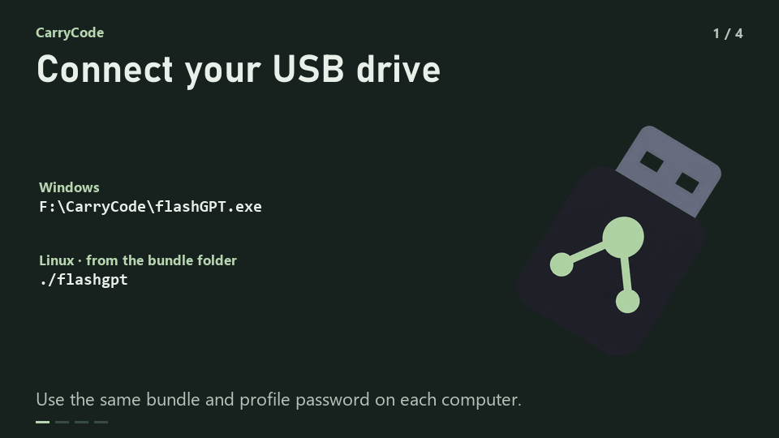

# CarryCode

**Fix problems. Code anywhere.** [English quick start](.github/README.md#quick-start)

CarryCode пригодится, если ты работаешь с кодом на нескольких компьютерах. Лаунчер, Codex CLI, OpenCode и зашифрованный профиль можно держать на одной флешке, чтобы на другом ПК открыть проект и продолжить работу или разобраться с ошибкой. Модели работают у облачного провайдера. Для AI-функций нужны интернет и вход в аккаунт.

## CarryCode Agent — экспериментальная альфа

В исходниках доступен собственный агент на Rust. После локальной сборки открой пункт **8 — CarryCode Agent (alpha)**, выбери папку и подключи провайдера. Для OpenAI-совместимого сервиса укажи базовый URL, например `https://example.org/v1`, затем ID модели и API-ключ. Для локального сервера допускается HTTP на localhost. Поддерживается также Anthropic Messages API. Дай подключению имя, чтобы сохранить его. Команда `/provider` показывает сохранённые подключения, `+` добавляет новое. Для Melious базовый адрес — `https://api.melious.ai/v1`, ID модели и ключ возьми в своём аккаунте.

Агент читает и ищет текстовые файлы, показывает предложения замены в существующих файлах и применяет подтверждённые правки. Запуск готовых задач Cargo, npm и unittest требует отдельного подтверждения. Скрипты проекта выполняются с правами пользователя. История и настройки автоматически попадают в зашифрованный профиль. `/help` открывает справку, `/sessions` — диалоги проекта, `/temporary` — временный чат, `/undo` отменяет последнюю правку после проверки содержимого файла.

### Модели

`/model` открывает менеджер моделей прямо в интерфейсе агента. В списке видны сохранённые подключения, активная модель отмечена точкой. **Enter** подключает выбранную, **a** добавляет, **e** изменяет, **d** удаляет. В форме задаются название, протокол (OpenAI-совместимый или Anthropic Messages), базовый URL, ID модели, API-ключ, окно контекста в токенах и режим «только чат». Ключ хранится только в зашифрованном профиле и при вводе маскируется; пустое поле при редактировании оставляет прежний ключ. Окно контекста показывает заполнение `ctx` в статусной строке. `/provider` остаётся быстрым способом добавить подключение через обычные строки ввода.

### Скиллы

Скилл — это папка с `SKILL.md`: YAML-заголовок с `name` и `description`, затем инструкции в Markdown. Агент показывает список в `/skills`, подгружает инструкции по запросу модели и передаёт их как доверенное руководство проекта. Формат совместим с Claude Code, поэтому подойдут существующие скиллы.

| Где искать | Назначение |
| --- | --- |
| `<проект>/.carrycode/skills/<имя>/SKILL.md` | только этот проект |
| `skills/<имя>/SKILL.md` в папке комплекта | вместе с флешкой |
| `%USERPROFILE%\.carrycode\skills\<имя>\SKILL.md` | все проекты пользователя |
| `%USERPROFILE%\.agents\skills`, `.claude\skills`, `.codex\skills` | общие наборы других агентов |

Встроенные скиллы `code-review`, `debug-project` и `skill-writer` уже находятся в бинарнике. В `skill-writer` лежит готовый промт для ChatGPT: скопируй его, подставь свою задачу и сохрани полученный `SKILL.md` в одну из папок выше. Первый скилл с таким именем выигрывает, поэтому проектный вариант перекрывает встроенный.

### MCP

Агент умеет запускать локальные MCP-серверы по stdio и вызывать их инструменты. Конфигурация читается из `<проект>/.carrycode/mcp.json` и `%USERPROFILE%\.carrycode\mcp.json`; проектный файл перекрывает пользовательский по имени сервера.

```json
{
  "servers": {
    "filesystem": {
      "command": "npx",
      "args": ["-y", "@modelcontextprotocol/server-filesystem", "C:\\project"],
      "env": {"TOKEN": "..."},
      "enabled": true,
      "startup_timeout_sec": 20,
      "tool_timeout_sec": 120
    }
  }
}
```

`/mcp` показывает состояние серверов и их инструменты, перезапускает их и импортирует готовые конфигурации из Claude Code (`~/.claude.json`, `.mcp.json`), Codex (`~/.codex/config.toml`) и OpenCode (`opencode.jsonc`). Импорт записывает выбранные серверы в пользовательский файл CarryCode. Каждый вызов MCP-инструмента показывается отдельным подтверждением с аргументами; секретные поля вроде `token` и `password` в нём скрыты. Поддерживается только stdio; удалённые HTTP/SSE-серверы пока не подключаются. Конфигурация может содержать ключи — не добавляй её в Git.

### /init

`/init` собирает сведения о проекте (стек, команды проверки, верхний уровень структуры) и показывает готовый `AGENTS.md` в прокручиваемом предпросмотре. **Enter** создаёт файл, **Esc** отменяет. Существующий `AGENTS.md` не перезаписывается. Файл читает встроенный агент, а также другие инструменты, которые поддерживают это соглашение.

Альфа ограничивает одну цепочку двенадцатью вызовами модели, контекст — 512 КиБ текста, чтение файла — 64 КиБ, поиск — 2000 записями и 50 совпадениями, тело скилла — 64 КиБ, результат MCP-инструмента — 64 КиБ. Пользовательские команды оболочки и создание файлов, кроме `/init`, пока не поддерживаются. MCP-серверы запускаются с правами пользователя; вызов каждого инструмента подтверждается. При остановке сетевого запроса ожидание может продолжаться до сетевого тайм-аута. Сравнение качества с Codex и Claude Code ещё не выполнено.

`cargo run --locked -p xtask -- package-lite` собирает лёгкий ZIP из двух подготовленных лаунчеров. Полный комплект собирается командой `package` и включает Codex и OpenCode. Контрольные суммы Lite записываются в `SHA256SUMS-lite`.

## Быстрый старт

1. Скачай установщик Windows или переносимый ZIP и проверь SHA-256. Установи или распакуй комплект в папку на USB, например `F:\CarryCode`. [Последний выпуск](https://github.com/harzer228/flashGPT/releases/latest)
2. Открой `flashGPT.exe` в Windows или запусти `./flashgpt` из каталога комплекта в терминале Linux. Создай и запомни пароль профиля или введи прежний.
3. Выбери Codex или OpenCode, затем папку проекта. Подтверди папку строкой «Выбрать эту папку» или клавишей **F2**. Войди через интерфейс Codex или команду `/connect` в OpenCode.
4. Перед извлечением флешки выйди из CLI, дождись сохранения и закрой меню. На другом ПК открой тот же комплект и введи тот же пароль.

При обновлении с flashGPT закрой лаунчер и CLI и выбери существующую папку. Сохраняй `flashgpt.json` вместе с `profile/`. Имена файлов запуска `flashGPT.exe` и `flashgpt` сохранены для совместимости с ярлыками и скриптами.

В проводнике **↑/↓** и **Enter** открывают папки, **←** поднимает на уровень выше, **Tab** показывает недавние папки, **/** ищет по имени, **F10** открывает действия. **6 — Язык / Language** меняет язык интерфейса, включая подсказки при следующем запуске.



## Проверка загрузки

Скачай проверяемый файл и его контрольную сумму **из одного выпуска**. Для установщика это файл `flashGPT-setup-windows-x64.exe.sha256`, для ZIP — `SHA256SUMS`. Установщик Windows выпускается без цифровой подписи.

В PowerShell для установщика сравни два SHA-256. Для ZIP подставь `flashgpt-usb-amd64.zip` и `SHA256SUMS`.

```powershell
Get-FileHash -Algorithm SHA256 .\flashGPT-setup-windows-x64.exe
Get-Content .\flashGPT-setup-windows-x64.exe.sha256
```

В Linux проверь ZIP в том же каталоге перед распаковкой.

```sh
sha256sum -c SHA256SUMS
```

## Поддерживаемые системы

| ОС | Архитектура | Запуск из папки комплекта |
| --- | --- | --- |
| Windows 11 | x86-64 | `flashGPT.exe` |
| Ubuntu 24.04 LTS | x86-64 | `./flashgpt` |
| Arch Linux | x86-64 | `./flashgpt` |

## Требования и ограничения

- **Компьютер и носитель.** Нужны доверенный ПК, интерактивный терминал, обычные права пользователя и доступная для записи флешка. Для общего носителя Windows и Linux подходит exFAT. В Linux права файлов и параметры монтирования должны разрешать запуск.
- **Работа с моделью.** На флешке находятся лаунчер, CLI и профиль. Модель остаётся у провайдера. Интернет и авторизация нужны для AI-сеанса, а установщик и локальные проверки комплекта работают офлайн.
- **Проекты.** Папка проекта должна быть доступна на текущем ПК. В профиль входят поддерживаемые настройки и данные входа CLI. Храни проект отдельно там, где он нужен.
- **Автооткрытие.** Его включают отдельно на каждом компьютере. При первом подключении на новом ПК запусти лаунчер вручную.

## Диагностика и исправление

- **3 → Диагностика** открывает агента в режиме чтения. Он помогает сопоставить ошибку с файлами проекта и предложить следующие проверки.
- **3 → Исправление** начинает с предложения в режиме чтения. Скопируй блок JSON агента перед выходом из CLI. Вставь его в CarryCode и введи `:end` на отдельной строке. Проверь объяснение, путь и строки замены, затем введи показанный код подтверждения. Мастер применяет одну замену в существующем текстовом файле проекта до 1 МиБ с обычными правами пользователя.
- **4 → Проверить комплект** показывает, что прошло, что завершилось сбоем и что пришлось пропустить. Для каждого сбоя указано, что проверить дальше. Проверка включает носитель, целостность CLI, пробный запуск CLI и песочницу Codex. В папке комплекта выполни `./flashgpt doctor` в Linux или `.\flashGPT.exe doctor` в PowerShell.
- **4 → Проверить HTTPS** отправляет HEAD-запрос без авторизации. Ответ показывает доступность адреса. Вход и доступ к модели можно проверить отдельным запросом из CLI.

## Автооткрытие

Пункт «Автозапуск» в главном меню показывает текущее состояние и переключает его одним выбором. Выключение действует сразу и оставляет текущее окно открытым. Помощник текущего пользователя распознаёт зарегистрированную флешку и открывает экран ввода пароля. Для управления из папки комплекта используй `./flashgpt autostart install` в Linux или `.\flashGPT.exe autostart install` в PowerShell. Подставь `status` для проверки или `uninstall` для удаления помощника.

Windows регистрирует запуск помощника в `HKCU\Software\Microsoft\Windows\CurrentVersion\Run`. Linux использует XDG Autostart и UDisks2. В GNOME для открытия окна сразу после подключения включи автоматическое монтирование и используй GNOME Terminal, GNOME Console или xterm. В TTY смонтируй флешку и запусти `./flashgpt` вручную. Если меню уже открыто, после повторного подключения им можно пользоваться в том же окне. Закрой меню перед безопасным извлечением флешки, чтобы освободить профиль. Команда `autostart status` показывает регистрацию, а `autostart uninstall` удаляет её. Перед обновлением установленного помощника выполни `uninstall`, обнови файлы и повтори `install`.

## Профиль

Чтобы сменить пароль, выбери **7 — Сменить пароль**, введи текущий пароль и дважды новый. Enter с пустым вводом отменяет смену. Сохранённый вход в оба CLI и недавние папки остаются в профиле. Ранее сделанные резервные копии открываются паролем, который действовал при их создании.

При первом запуске создаётся ID комплекта в `flashgpt.json`. Сохраняй этот файл и каталог `profile/` вместе. Снимки зашифрованы паролем в формате age. Для резервного копирования достаточно скопировать их после закрытия меню. Если старый токен отозван или истёк, войди снова в нужном CLI.

Пока CLI работает, профиль расшифрован в приватный временный каталог. После штатного выхода CarryCode удаляет этот каталог. После сбоя такой каталог может остаться в `%LOCALAPPDATA%\flashGPT\sessions` на Windows или в `$XDG_RUNTIME_DIR` либо `~/.local/share/flashgpt/sessions` на Linux. При сбое записи сначала подключи тот же носитель и повтори сохранение. Если это невозможно, сохрани предложенную зашифрованную копию. Для восстановления закрой все сеансы, скопируй `profile/` в резервное место и помести копию в `profile/snapshot-0.age` рядом с исходным `flashgpt.json`. Сохрани второй снимок отдельно при ручном откате. Меню выбирает самый новый читаемый снимок.

## Сборка

Установи указанный в `rust-toolchain.toml` Rust и штатный компоновщик системы. Из корня репозитория:

```text
cargo test --locked --workspace
cargo run --locked -p xtask -- prepare
cargo run --locked -p xtask -- build
```

`prepare` скачивает официальные версии из `runtimes.lock.json`, проверяет SHA-256 и создаёт манифест. `build` создаёт лаунчер текущей платформы со встроенным манифестом. Для переносимой Linux-сборки на Ubuntu используй пакет `musl-tools` и следующие команды.

```sh
rustup target add x86_64-unknown-linux-musl
export CARGO_TARGET_X86_64_UNKNOWN_LINUX_MUSL_LINKER=musl-gcc
export CC_x86_64_unknown_linux_musl=musl-gcc
cargo run --locked -p xtask -- build x86_64-unknown-linux-musl
```

Для общего архива собери Windows и Linux на соответствующих системах, собери результаты в `dist/launchers/`, затем выполни команду упаковки.

```text
cargo run --locked -p xtask -- package
```

Результат появится в `dist/`. Для upstream-клиентов действуют их лицензии из `licenses/`.

Чтобы собрать установщик из готового ZIP, выполни в PowerShell на Windows `./installer/build.ps1 -Version 0.1.0-beta.5`. Скрипт использует переносимый компилятор Inno Setup и сохраняет EXE с отдельной контрольной суммой в `dist/`.

## Quick start

CarryCode carries the launcher, Codex CLI, OpenCode CLI, and your encrypted profile on USB. The bundle targets Windows 11, Ubuntu 24.04 LTS, and Arch Linux on x86-64. Models run online with your provider and require internet access and an active sign-in.

1. Download the beta ZIP from [Releases](https://github.com/harzer228/flashGPT/releases) and check its SHA-256 against `SHA256SUMS`. Extract it to a folder on the USB drive.
2. Open `flashGPT.exe` on Windows or run `./flashgpt` from a terminal in that folder on Linux.
3. Set or enter the profile password. Choose **6 — Язык / Language**, then **2 — English**. The choice stays on the USB drive and applies to the password prompt on the next launch.
4. Choose Codex or OpenCode, then select a working folder. Use the arrow keys to move and Enter to open the focused item. Choose **Choose this folder** or press **F2** to confirm the current folder.
5. Sign in to your cloud provider on first use. Exit the client, wait for the profile to save, and close the menu before ejecting the drive.

Use **5 — Autostart** to enable or disable the USB watcher on the current computer.

Use **7 — Change password** to re-encrypt your profile. In the folder picker, press **Tab** for recent folders, **/** to search by name, and **F10** for more actions. [Supported systems and verification instructions](.github/README.md#supported-systems)

## Участие в проекте

[Руководство контрибьютора](CONTRIBUTING.md) · [Сообщить об ошибке или предложить улучшение](https://github.com/harzer228/flashGPT/issues/new/choose)
